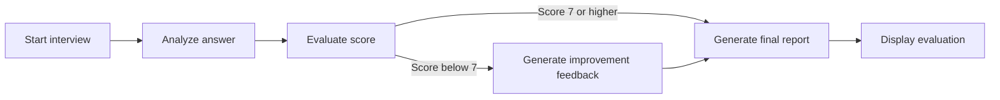

# 🎯 PlacementSathi — AI Placement Feedback Assistant

[](https://streamlit.io/)
[](https://www.python.org/)
[](https://www.langchain.com/)
[](https://www.langchain.com/langgraph)

**Practice with purpose. Interview with confidence.**

PlacementSathi is an AI-powered interview coach that helps students prepare for technical and corporate assessments. It uses a stateful LangGraph workflow and the Google Gemini API to generate role-specific interview questions, assess responses, and provide actionable feedback.

## ✨ Project Overview

The application guides a candidate through a focused interview practice session: choose a target role, generate or enter a question, submit an answer, and receive a structured evaluation. LangGraph orchestrates the assessment as a sequence of state-aware steps, routing answers that need improvement through a feedback stage before producing a final report.

The Streamlit interface is designed as a responsive “Deep Space” workspace, pairing a dark palette with frosted glass surfaces to make the practice experience feel focused and polished.

## 🚀 Key Features

- **Deep Space interface:** Custom dark theme, glassmorphism-inspired cards, responsive layout, and an electric-blue-to-purple visual accent.
- **Role-specific practice:** Generate technical interview questions based on the selected career role, or enter a question manually.
- **Structured answer evaluation:** Assess technical correctness, relevance, clarity, and completeness on a 10-point scale.
- **Personalized coaching:** Receive improvement suggestions and a sample stronger answer when an evaluation indicates further practice may help.
- **Downloadable report:** Review and download a final interview evaluation report.
- **Agentic workflow orchestration:** LangGraph coordinates analysis, scoring, conditional feedback, and report generation while passing interview state between workflow steps.
- **Tracing and observability:** LangSmith can capture LangChain/LangGraph execution traces to help inspect and debug workflow runs.

## 🧰 Tech Stack

| Area | Technology |
| --- | --- |
| Frontend | Streamlit |
| Orchestration | LangGraph and LangChain |
| Large language model | Google Gemini (`gemini-1.5-flash`) |
| Observability | LangSmith |
| Configuration | `python-dotenv` |

## ⚙️ Local Installation & Setup

### Prerequisites

- Python 3.10 or later
- Git
- A Google AI Studio API key for Gemini
- A LangSmith API key if you want execution tracing

### 1. Clone the repository

Replace the example URL with the HTTPS URL for this repository:

```bash
git clone https://github.com/<your-username>/<your-repository>.git
cd <your-repository>
```

### 2. Create and activate a virtual environment

Create the environment:

```bash
python -m venv myenv
```

Activate it on Windows PowerShell:

```powershell
.\myenv\Scripts\Activate.ps1
```

On Windows Command Prompt:

```bat
myenv\Scripts\activate.bat
```

On macOS or Linux:

```bash
source myenv/bin/activate
```

### 3. Install dependencies

```bash
python -m pip install --upgrade pip
pip install -r requirements.txt
```

### 4. Configure environment variables

Create a file named `.env` in the repository root:

```dotenv
GEMINI_API_KEY=your_google_gemini_api_key
LANGCHAIN_TRACING_V2="true"
LANGCHAIN_API_KEY=your_langsmith_api_key
```

Get a Gemini API key from [Google AI Studio](https://aistudio.google.com/app/apikey). Get a LangSmith API key from [LangSmith](https://smith.langchain.com/). Keep both values private. LangSmith tracing requires a valid LangSmith API key; do not commit real credentials.

> **Security:** `.env` must remain in `.gitignore`. This repository already ignores `.env`; do not remove that rule or paste API keys into source code, README files, screenshots, or commits.

### 5. Run the application

```bash
streamlit run app.py
```

Streamlit prints a local URL (usually `http://localhost:8501`) where you can open the app in your browser.

## 🧭 Interview Workflow



The workflow evaluates each response against four criteria: technical correctness, relevance, clarity, and completeness. Answers scoring below 7 are routed through the feedback step before the final report is generated.

## 🔐 Privacy & Responsible Use

- Store API credentials in your local `.env` file and keep it out of version control.
- Interview responses are sent to the configured language-model provider for evaluation.
- Use the feedback as practice guidance. It is AI-generated and does not represent an official hiring decision.

## 🛠️ Troubleshooting

- **Missing or invalid Gemini credentials:** Check that `GEMINI_API_KEY` is set in the root `.env` file and that your Google AI Studio key is active.
- **LangSmith traces are missing:** Verify `LANGCHAIN_TRACING_V2` and `LANGCHAIN_API_KEY`. Tracing is optional for running the interview workflow.
- **Dependencies fail to install:** Confirm the virtual environment is active and that you are using a supported Python version.
- **Streamlit command is not found:** Activate the virtual environment, then run `python -m streamlit run app.py`.